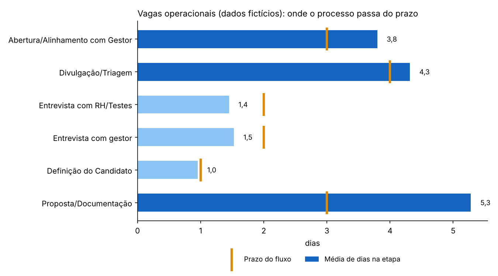

# 1. Contratar: SLA de recrutamento por etapa

Parte do [ciclo de pessoas](../README.md). Dados fictícios.

## O ponto de partida

O recrutamento trabalhava com um prazo único de 30 dias para fechar qualquer vaga. Para transformar esse prazo em gestão, criei um painel no Power BI que registra cada vaga, a etapa em que ela está e há quantos dias segue aberta. Com ele, o SLA passou a ser acompanhado com dados, etapa por etapa.

## Do painel ao estudo

Com o tempo de cada etapa medido, os dados mostraram em quais pontos as vagas ganhavam ritmo e em quais perdiam. Levei esse diagnóstico para a coordenação de recrutamento e conduzimos juntos um estudo de alguns meses sobre o fluxo.

O estudo virou o teste de um processo novo: prazos menores e separados por perfil de vaga, com 15 dias para as operacionais e 25 para as estratégicas, e atenção maior às etapas que mais pesavam no tempo total. O painel continua medindo cada etapa e mostra onde estão as próximas ações.

## Onde a IA entrou

Construí as medidas do painel para o SLA único, e elas funcionavam para ele. Com o processo novo, a lógica precisava mudar, porque cada perfil de vaga passou a ter o próprio prazo por etapa. Extraí as mais de 30 medidas pelo DAX Studio e usei o Claude para adaptá-las ao novo fluxo e conferir cada regra contra o documento oficial do processo. Validei os resultados recalculando os números em Python antes de colocar o painel novo em uso.

Próximo passo, em estudo: automatizar com o Power Automate o envio semanal das vagas críticas à gerência.

## Arquivos

- `dax/`: colunas e medidas adaptadas ao novo fluxo, prontas para colar no Power BI
- `dados/`: requisições e histórico de etapas fictícios
- `gerar_dados_exemplo.py`: gera os dados e o gráfico (`pip install pandas numpy matplotlib`)
