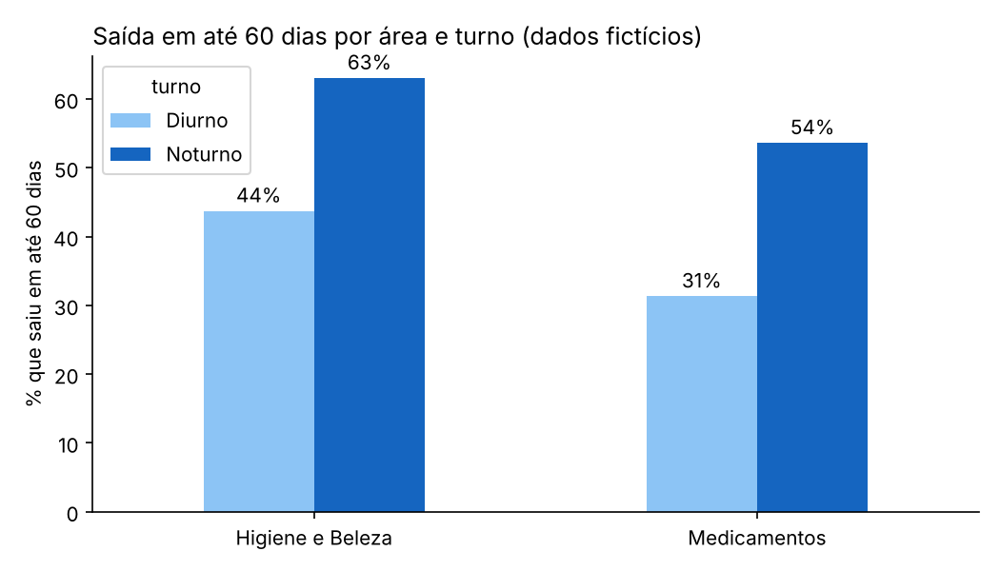
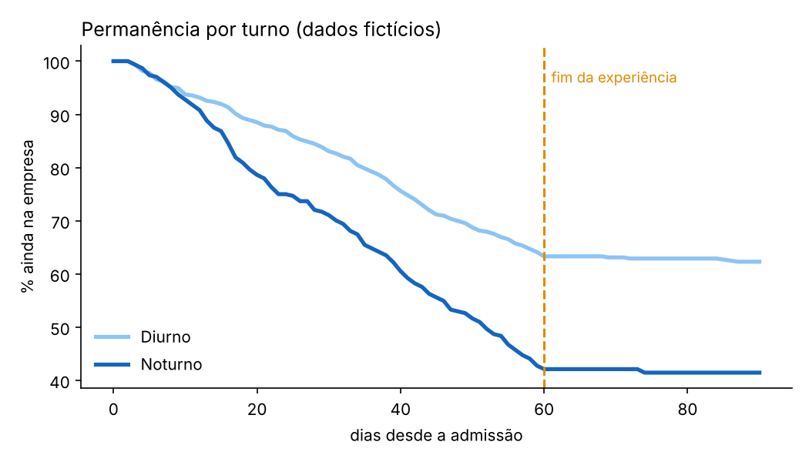

# 2. Reter: do diagnóstico ao plano de retenção

Parte do [ciclo de pessoas](../README.md). Dados fictícios.

## O que os dados mostraram

O painel de desligamentos revelou que uma parte grande das saídas acontecia **antes de o contratado completar 60 dias**, ainda no período de experiência. Cada saída dessas é uma vaga que volta para o recrutamento, mais uma rescisão paga.

## A cadeia de análises

Em vez de olhar a taxa de turnover sozinha, liguei as pontas do ciclo de vida do colaborador:

1. **Quem contratamos**: o perfil de cada admissão, vindo do [painel de vagas](../01-recrutamento-sla).
2. **Quem fica e quem sai**: permanência por turno, área, idade e cargo.
3. **Por que sai**: os motivos dos formulários de desligamento.
4. **O que fazer**: treinamentos ligados aos motivos mais citados, capacitação dos líderes desses times e um acompanhamento do líder nos primeiros 60 dias.
5. **Quanto se economiza**: menos rescisões e menos vagas de reposição, dinheiro que pode voltar para a capacitação ([treinamentos e custos](../04-treinamentos-e-custos)).

## Exemplo de como um motivo vira ação

| Motivo citado no desligamento | Resposta no plano de retenção |
| --- | --- |
| Relação com a liderança | Formação dos líderes em feedback e acompanhamento |
| Expectativa diferente da função | Integração reforçada e conversa aos 15, 30 e 45 dias |
| Jornada ou turno | Alinhar a rotina real já na entrevista |
| Proposta de outra empresa | Plano de desenvolvimento e trilha de crescimento visível |

A tabela mostra a estrutura do plano; os motivos e as ações reais ficam no painel interno.

## Onde a IA entrou

Usei o Claude como par de análise: ele cruzou as bases de admitidos e desligados e escreveu a primeira versão do código em pandas; eu revisei a lógica da coorte, conferi os números e decidi quais cortes faziam sentido para o negócio. O próximo passo é usar IA para classificar as respostas abertas dos formulários e alimentar o painel automaticamente.

## Arquivos

- `analise_turnover_precoce.ipynb`: a análise de permanência, com os gráficos
- `gerar_dados_sinteticos.py`: gera a base fictícia de 800 contratados
- `dados/admitidos_sinteticos.csv`: a base fictícia
