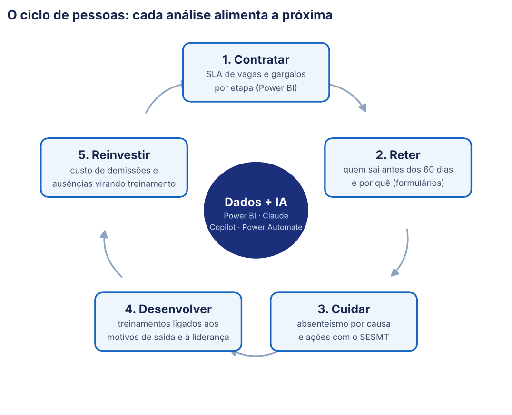

# Ciclo de pessoas: People Analytics com IA

Quando entrei no RH, a empresa não tinha uma área de dados de pessoas. Construí os painéis do zero, e o trabalho foi além dos números: hoje conseguimos ver quem contratamos, quem fica, quem sai e por quê, quanto isso custa e onde vale reinvestir esse dinheiro em vez de gastá-lo com demissões e ausências.

Os projetos se ligam em um ciclo: cada análise alimenta a próxima.

## Os projetos

| Etapa | Projeto | O que responde | Nesta pasta |
| --- | --- | --- | --- |
| 1. Contratar | [SLA de recrutamento por etapa](01-recrutamento-sla) | Onde cada vaga atrasa e quanto tempo levamos para contratar | DAX, dados fictícios e gráfico |
| 2. Reter | [Retenção e turnover precoce](02-retencao-turnover-precoce) | Quem sai cedo, por quê, e o que fazer para segurar | Análise em Python com dados fictícios |
| 3. Cuidar | [Absenteísmo](03-absenteismo) | Por que as pessoas faltam e quais ações reduzem isso | Descrição do projeto |
| 4 e 5. Desenvolver e reinvestir | [Treinamentos e custos](04-treinamentos-e-custos) | Quanto custam as saídas e como virar isso em capacitação | Descrição do projeto |

## Bastidores técnicos

Os dados saem do sistema de RH em planilhas brutas. Trato tudo no Power Query, com código M escrito no editor avançado (limpeza, junção de arquivos mensais por pasta e padronização de datas e códigos), e organizo cada painel em modelos estrela: fatos de admissões, desligamentos, vagas e atestados ligados a dimensões de calendário, empresa, centro de custo e gestor. As medidas são escritas em DAX e conferidas no DAX Studio.

## Onde a IA entrou

A IA não substituiu a análise: acelerou o que levaria semanas e me deixou tempo para a parte de negócio.

| Etapa | Ferramenta | O que fez |
| --- | --- | --- |
| Contratar | Claude + DAX Studio | Revisou as medidas do painel contra o fluxo oficial e reaplicou o DAX ao novo SLA |
| Contratar | Power Automate (em estudo) | Envio semanal automático à gerência do quadro de vagas e das vagas críticas |
| Reter | Claude + Python | Cruzou as bases de admitidos e desligados e montou a análise de permanência |
| Cuidar | Claude | Agrupou os atestados por causa e cruzou com o quadro de cada empresa |
| Todas | Copilot no Power BI | Acelera medidas DAX e resumos dos painéis |
| Todas | Claude | Transforma as análises em apresentações para a diretoria e o RH |

## Sobre os dados

Nenhum dado de pessoa ou da empresa está aqui. Os arquivos de dados são fictícios, gerados por script no mesmo formato das bases reais, em respeito à LGPD.

---
Kaio Santos · People Analytics · Administração FEA-RP/USP · [LinkedIn](https://www.linkedin.com/in/kaiofsants)
